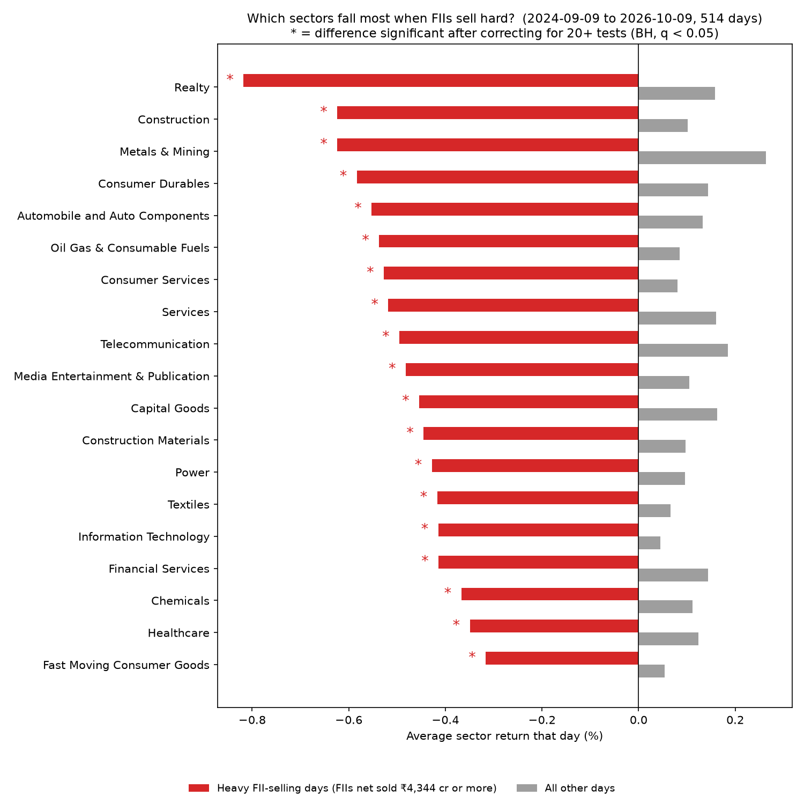
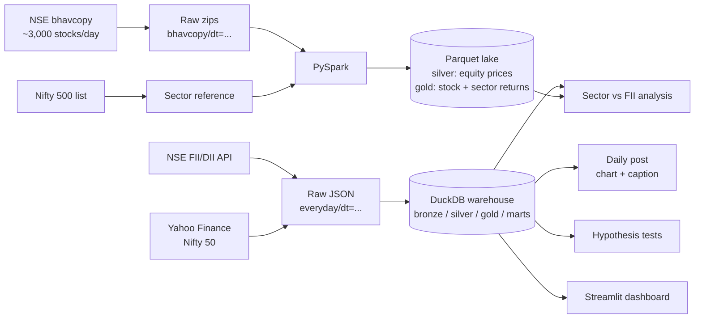

# FII/DII Flow Tracker


An automated data pipeline for the Indian stock market. Every trading day at 8 PM IST it:

1. collects foreign (FII) and domestic (DII) institutional flows and Nifty 50 prices,
2. downloads NSE's full end-of-day price file for ~3,000 stocks (the *bhavcopy*),
3. builds a DuckDB warehouse and a Parquet data lake (with PySpark),
4. tests whether common market beliefs about FII flows hold up, and
5. produces a ready-to-post chart.

No manual steps. Built with Airflow, Docker, PySpark, DuckDB and Python.

**Why:** FII flows are one of the most-discussed drivers of the Indian market, but NSE
publishes them as a single provisional figure each evening and keeps no history. This project
captures the data daily, keeps a clean history, and checks popular claims against the numbers.

## Results

**Which sectors fall most when FIIs sell heavily?** (514 trading days, Sep 2024 – Oct 2026)



- On the 103 days FIIs net sold ₹4,300 cr or more, **all 19 sectors fell**, each one
  statistically significant after correcting for multiple testing (Benjamini-Hochberg).
- Cyclical, rate-sensitive sectors fell about **2.5x** as much as FMCG (Realty −0.82%, FMCG −0.32%).
- **No sector kept falling the next day.** The market prices FII selling in on the same day.

**Does weak DII absorption predict a red next day?** A popular claim says that when DIIs
buy back less than 80% of FII selling, the next day is red. Over 3 months it looked true
(6 of 7 days). Over 2 years, with Fisher's exact test, Welch's t-test, Mann-Whitney U and a
permutation test, **the effect disappears**: next-day returns were the same as on any other day.

## Architecture



### The Airflow DAG (8 PM IST, Monday to Friday)

```
is_trading_day ─┬─ extract_fii_dii ─┐
                ├─ extract_nifty ───┴─ load_warehouse ─┬─ make_post
                │                                      │
                └─ extract_bhavcopy ── spark_bhavcopy ─┴─ analyze_sectors
```

- **`is_trading_day`** skips weekends and NSE holidays, using NSE's own holiday calendar.
- **`extract_fii_dii`** and **`extract_bhavcopy`** retry every 20 minutes until NSE has published that day's data.
- The two branches are **independent**: if the bhavcopy is late or Spark fails, the FII/DII warehouse and the daily post still go out.
- **`spark_bhavcopy`** runs as a separate process with a 45-minute timeout, so its JVM never lives inside the Airflow worker.

## Engineering decisions

| Problem | Decision |
|---|---|
| NSE returned **403** to every scripted request, even with browser headers | NSE's bot protection checks the **TLS fingerprint**. Switched from `requests` to `curl_cffi`, which impersonates Chrome's handshake. |
| NSE changed its bhavcopy format in July 2024 (different file names and columns) | The parser **detects the format from the header**, not the date, and maps both formats to one unified schema. A `source_format` column records which one each row came from. |
| One corrupt file shouldn't kill a 500-file Spark job | Parsing returns an **error marker row** instead of raising; the driver reports bad files and continues. |
| Splits and bonuses create fake −50% days | Returns use NSE's own adjusted `prev_close`. Moves beyond ±35% (above NSE circuit limits) are flagged `return_suspect` and excluded from sector averages. |
| Sector returns were biased toward the day's biggest movers | Weighting by **same-day** turnover over-weights stocks that spiked that day. Changed to the **previous 20 days'** average turnover, which is known before the day starts. This changed the conclusion (see Limitations). |
| Testing 19 sectors at once produces false positives | p-values are corrected with **Benjamini-Hochberg**. |
| Reruns must never duplicate data | Raw files are partitioned by **trading date** and overwritten on rerun. The warehouse is rebuilt from raw; Parquet uses dynamic partition overwrite. |
| NSE keeps no FII/DII history | Two years were backfilled; every row carries a `flow_source` column so backfilled data is always distinguishable. Pipeline data wins on overlap. |
| Airflow cron schedules run one interval late | Used `CronTriggerTimetable`, so the 8 PM run happens at 8 PM on the same day. |
| Airflow standalone (SQLite) hung on startup | Moved to **LocalExecutor + Postgres** with a separate web server and scheduler. |
| Why Parquet and not DuckDB for the stock data? | Spark writes Parquet natively, a DuckDB file allows one writer at a time, and Parquet can be read by any engine (Spark, DuckDB, pandas, Athena). DuckDB **queries the Parquet in place** (lakehouse pattern). |

## Data quality checks

**Warehouse** (every load): no duplicate trading days · FII and DII **net = buy − sell** ·
both FII and DII present every day · the date inside the NSE response matches its folder ·
backfill rows complete and unique.

**Lake** (every Spark run): no duplicate (date, symbol) · no missing or non-positive close ·
high ≥ low · at least 1,000 stocks per day.

## Tests and CI

19 unit tests cover the bhavcopy URL logic and format detection, both parsers and the unified
schema, error handling for corrupt files, and the sector statistics (checked on synthetic data
where the right answer is known). They run on every push with **GitHub Actions**.

```bash
pytest -q
```

## Tech stack

Python · Apache Airflow 2.10 · Docker Compose · PostgreSQL (Airflow metadata) · PySpark 3.5 ·
Parquet · DuckDB · pandas · SciPy · matplotlib · Streamlit · curl_cffi · GitHub Actions

## Project layout

```
dags/                    Airflow DAG
extract_*.py             extractors: FII/DII, Nifty, bhavcopy, sector list
backfill_*.py            one-off history loaders
load_warehouse.py        DuckDB: bronze -> silver -> gold -> marts, quality checks
spark_bhavcopy.py        PySpark: raw zips -> silver prices -> gold stock and sector returns
analyze_sectors.py       sector vs FII-flow statistics and charts
hypothesis_test.py       DII absorption hypothesis tests
make_post.py             daily chart + caption
dashboard.py             Streamlit dashboard
tests/                   unit tests
Dockerfile, docker-compose.yaml
```

## Run it

```bash
# Automated (Docker Desktop required)
docker compose up -d --build                # Airflow UI at http://127.0.0.1:8080

# History (one-off)
python backfill_nifty.py 2024-09-01
python extract_bhavcopy.py --start 2024-06-24
python extract_sectors.py
docker compose exec airflow-scheduler python /opt/airflow/project/spark_bhavcopy.py
```

## Limitations

- FII/DII figures are NSE's **provisional** cash-market data and may be revised later.
- **Survivorship bias:** sectors come from the *current* Nifty 500 list, so stocks that left the
  index are "Unclassified" and sector returns lean toward stocks that did well. Fixing this needs
  historical index membership.
- FII data is published after the market closes, so same-day results describe what happened;
  only next-day results could be acted on, and none were significant.
- Runs on a single machine. In production this would map to S3 (raw and lake), Glue or EMR
  (Spark), MWAA (Airflow) and Athena (queries).

**This project is for data analysis and learning. It is not investment advice.**
